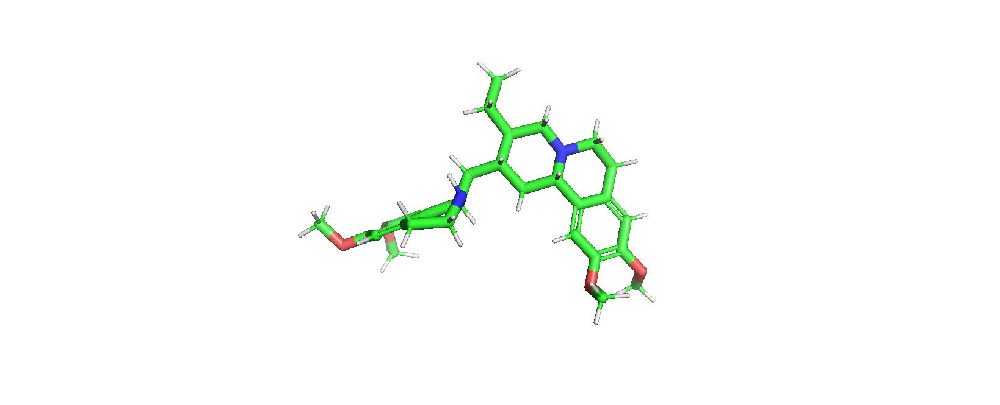
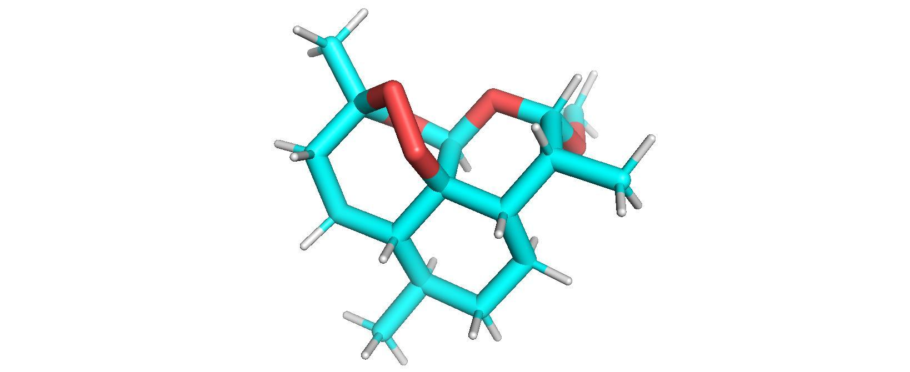
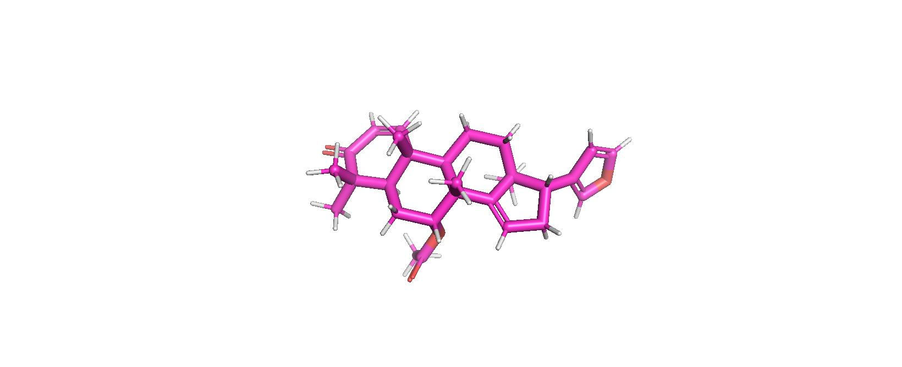
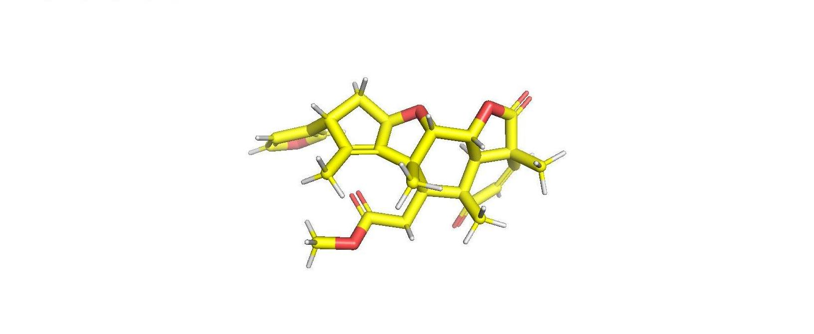
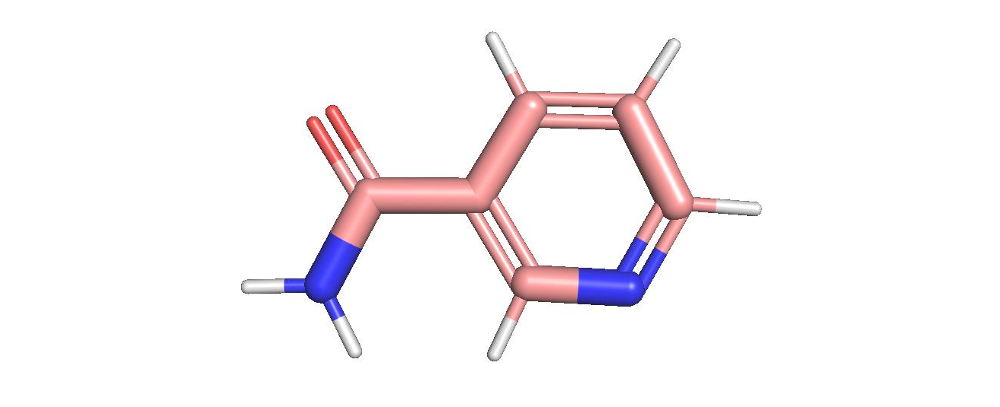
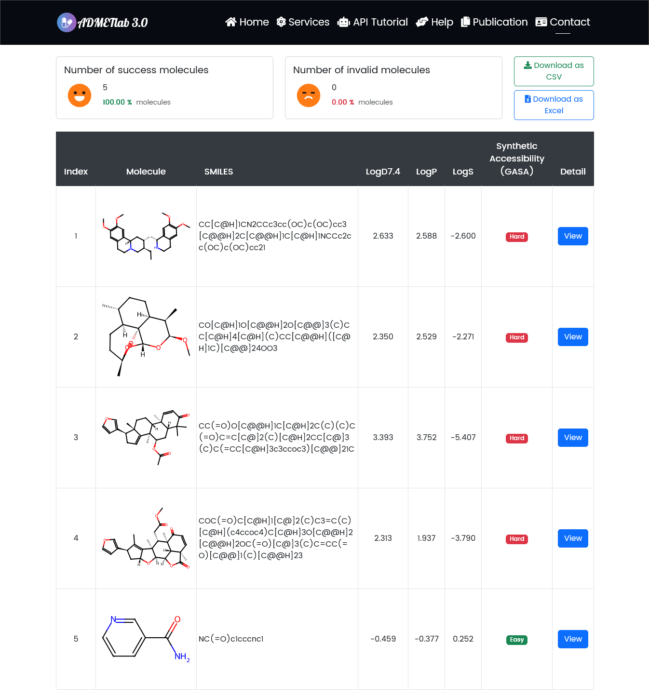

# Structure-Based Screening of Natural Allosteric Inhibitors for Mutant EGFR

Structure-based in silico screening and ADMET evaluation of natural product candidates targeting the allosteric binding site of drug-resistant mutant EGFR (`T790M/V948R`; PDB: `8TO4`).

## Overview

This repository contains the structural datasets, computational outputs, and visualizations from a capstone project completed during **The Insilico Lab** three-week virtual training program in Computer-Aided Drug Design (CADD). The study evaluates five natural compounds—**Emetine, Artemether, Azadirone, Nimbolide, and Nicotinamide**—as potential allosteric inhibitors of the double-mutant **Epidermal Growth Factor Receptor (EGFR T790M/V948R)** co-crystallized with the allosteric ligand **FRF-06-057** (`PDB: 8TO4`, X-ray diffraction, `2.99 Å` resolution, four chains).

The computational workflow comprised five stages:

1. **Drug-Likeness Screening:** Evaluating physicochemical properties and oral bioavailability against Lipinski's Rule of Five.
2. **Receptor Preparation:** Isolating Chain D, stripping crystallographic waters and bound heteroatoms, and assigning hydrogens and partial charges.
3. **Binding Cavity Prediction:** Identifying surface pockets and scoring druggability on the unmodified receptor chain.
4. **ADMET Profiling:** Predicting absorption, distribution, metabolism, excretion, and toxicity endpoints.
5. **AlphaFold3 Structural Comparison:** Folding the mutant EGFR sequence de novo and assessing backbone agreement against the experimental crystal structure.

### Key Highlights

- **Drug-Likeness:** All five candidates satisfy Lipinski's Rule of Five; four pass with zero violations, while Azadirone shows one borderline lipophilicity violation (`Consensus LogP = 5.06`).
- **Primary Allosteric Site:** Pocket `P_0` on Chain D is the largest and most druggable cavity (`volume = 1330.37 ų`, `drug score = 0.81`), lined by a predominantly hydrophobic and aromatic residue network.
- **ADMET Trade-Offs:** Nicotinamide exhibits the cleanest overall pharmacokinetic and toxicity profile, whereas the larger natural scaffolds carry predicted liver-injury (DILI), CYP3A4 inhibition, or hERG blockade liabilities.
- **AlphaFold3 Fidelity:** The predicted structure reproduces prepared experimental Chain D with an **RMSD of 0.889 Å** across **2,289 aligned atoms**.

## Tools and Web Servers

| Stage                         | Platform / Software           | Role in Workflow                                                       |
| :---------------------------- | :---------------------------- | :--------------------------------------------------------------------- |
| **Ligand Retrieval**          | PubChem                       | Compound CIDs, isomeric SMILES, and 3D conformers (`.sdf`)             |
| **Drug-Likeness**             | SwissADME                     | Physicochemical descriptors and Lipinski rule filtering                |
| **Receptor Source**           | RCSB PDB                      | Experimental coordinates (`8TO4.pdb`) and FASTA sequence               |
| **Protein Preparation**       | UCSF Chimera                  | Chain D isolation, water/heteroatom removal, and Dock Prep             |
| **Pocket Prediction**         | DoGSiteScorer (ProteinsPlus)  | Cavity volume, depth, residue mapping, and druggability scoring        |
| **ADMET Screening**           | ADMETlab 3.0                  | Batch pharmacokinetic and toxicity endpoint predictions                |
| **Structure Prediction**      | AlphaFold Server (AlphaFold3) | De novo 3D structure modeling from the receptor FASTA sequence         |
| **Visualization & Alignment** | PyMOL                         | 3D structural superposition (`align`), RMSD calculation, and rendering |

All steps were executed through web servers and desktop molecular modeling tools; no custom scripts were required for this phase.

## Repository Structure

```text
.
├── data/
│   ├── Prepared/
│   │   ├── 8TO4_prepared.pdb                   # Cleaned Chain D with hydrogens and Gasteiger charges
│   │   └── alphafold3_output/
│   │       ├── fold_egfr_mutant_8to4.zip       # Full AlphaFold Server output archive
│   │       └── fold_egfr_mutant_8to4_model_0.cif
│   └── Raw/
│       ├── 8TO4.pdb                            # Original crystal structure from RCSB PDB
│       ├── rcsb_pdb_8TO4.fasta                 # Target receptor FASTA sequence
│       ├── *_Conformer3D_COMPOUND_CID_*.sdf    # 3D ligand conformers from PubChem
│       ├── ADMETLab3 Output/                   # Raw ADMETlab 3.0 batch tables (.csv, .xlsx)
│       └── DoGSiteScorer Output/               # Pocket descriptors, CCP4 grids, and residue PDBs
├── results/
│   ├── ADMETLAB_screenshots/                   # Per-ligand ADMET plots and batch summary dashboard
│   ├── Structures/                             # PyMOL structure renders and server screenshots
│   └── SwissADME/                              # Per-ligand SwissADME screenshots and summary (.csv)
└── README.md
```

## Methodology and Results

### 1. Drug-Likeness Screening

Compound CIDs and isomeric SMILES were retrieved from PubChem and batch-analyzed in **SwissADME** against Lipinski's thresholds (`MW ≤ 500 Da`, `HBD ≤ 5`, `HBA ≤ 10`, `Consensus LogP ≤ 5`). Corresponding 3D conformers were downloaded in `.sdf` format and rendered in PyMOL.

| Compound         | PubChem CID | MW (Da) | HBD | HBA | Consensus LogP | Lipinski Violations |
| :--------------- | :---------: | :-----: | :-: | :-: | :------------: | :-----------------: |
| **Emetine**      |    10219    | 480.64  |  1  |  6  |      4.22      |          0          |
| **Artemether**   |    68911    | 298.37  |  0  |  5  |      2.73      |          0          |
| **Azadirone**    |  10906239   | 436.58  |  0  |  4  |      5.06      |          1          |
| **Nimbolide**    |  12313376   | 466.52  |  0  |  7  |      3.11      |          0          |
| **Nicotinamide** |     936     | 122.12  |  1  |  2  |      0.10      |          0          |

Four candidates satisfy every Lipinski parameter without violation. **Azadirone** is the single borderline case with a Consensus LogP of `5.06`, just above the `5.0` cutoff. Because Lipinski's framework permits one violation for orally active compounds, Azadirone was retained while flagged for solubility and metabolic scrutiny during ADMET profiling.

|                  Emetine                   |                    Artemether                    |                   Azadirone                    |                   Nimbolide                    |                     Nicotinamide                     |
| :----------------------------------------: | :----------------------------------------------: | :--------------------------------------------: | :--------------------------------------------: | :--------------------------------------------------: |
|  |  |  |  |  |

_Figure 1. PyMOL 3D conformer renders of the five screened ligands. Individual SwissADME outputs are stored in `results/SwissADME/`._

### 2. Protein Preparation

The raw `8TO4.pdb` file contains four receptor copies (Chains `A–D`), 70 crystallographic water molecules, and three bound heteroatom species: the ATP analog `ANP`, a catalytic `Mg²⁺` ion, and the co-crystallized allosteric inhibitor `IXR` (FRF-06-057). Using **UCSF Chimera**, Chains `A–C`, all water molecules, and all heteroatoms were removed to leave an unoccupied Chain D receptor template. Polar and non-polar hydrogens were added and Gasteiger charges were assigned via **Dock Prep**, producing `data/Prepared/8TO4_prepared.pdb`.

| Property                  | Specification                                                    |
| :------------------------ | :--------------------------------------------------------------- |
| **Target Receptor**       | Mutant EGFR (`T790M/V948R`) with allosteric inhibitor FRF-06-057 |
| **Method and Resolution** | X-ray diffraction, `2.99 Å`                                      |
| **Chains in Raw File**    | A, B, C, D                                                       |
| **Chain Retained**        | D                                                                |
| **Removed Components**    | Chains A–C, 70 water molecules, `ANP`, `Mg²⁺`, `IXR`             |
| **Added Parameters**      | Hydrogens and Gasteiger charges (UCSF Chimera Dock Prep)         |

|             Raw 8TO4 Homotetramer              |                      Prepared Chain D                       |
| :--------------------------------------------: | :---------------------------------------------------------: |
|  |  |

_Figure 2. Comparison of the unprocessed 8TO4 structure and the cleaned, protonated Chain D receptor in PyMOL._

### 3. Binding Site Prediction

To avoid preparation-induced artifacts, pocket detection was performed directly on Chain D of the raw `8TO4.pdb` structure using **DoGSiteScorer**. Eight cavities were identified, with **Pocket `P_0`** standing out by both volume (`1330.37 ų`) and druggability (`drug score = 0.81`).

| Pocket  | Volume (ų) | Surface Area (Ų) | Depth (Å) | Simple Score | Drug Score |
| :------ | :---------: | :---------------: | :-------: | :----------: | :--------: |
| **P_0** |   1330.37   |      1923.72      |   34.68   |     0.66     |    0.81    |
| **P_1** |   939.90    |      1107.01      |   15.73   |     0.64     |    0.80    |
| **P_2** |   156.99    |      233.00       |   11.93   |     0.00     |    0.41    |

Pocket `P_0` is lined by **59 residues**, combining a hydrophobic and aromatic core (`Leu730`, `Trp731`, `Phe795`, `Tyr801`, `Tyr813`, `Trp817`) with charged and polar residues (`Arg705`, `Glu711`, `Asp770`, `Asn771`, `Arg776`, `Gln791`). This amphipathic environment matches the binding profile of allosteric inhibitors such as FRF-06-057 and defines the spatial coordinates for subsequent docking grid generation (`data/Raw/DoGSiteScorer Output/residues/`).

|                       DoGSiteScorer Pocket Ranking                       |                                 Pocket P_0 Surface View                                  |
| :----------------------------------------------------------------------: | :--------------------------------------------------------------------------------------: |
|  |  |

_Figure 3. Predicted binding cavities on Chain D and surface visualization of top-ranked pocket `P_0` in PyMOL._

### 4. ADMET Prediction

Isomeric SMILES for all five ligands were submitted to **ADMETlab 3.0** (`data/Raw/ADMETLab3 Output/`). Two representative endpoints from each of the five ADMET categories are listed below (Caco-2 in log permeability units, plasma protein binding in `%`, clearance in `mL/min/kg`, and classification endpoints as predicted probabilities).

| Endpoint                        | Emetine  | Artemether | Azadirone | Nimbolide | Nicotinamide |
| :------------------------------ | :------: | :--------: | :-------: | :-------: | :----------: |
| **Caco-2 Permeability**         |  -5.02   |   -4.85    |   -4.95   |   -4.99   |    -4.40     |
| **Intestinal Absorption (HIA)** |  0.0004  |   0.0018   |  0.0040   |  0.0013   |    0.0006    |
| **Blood-Brain Barrier (BBB)**   | 0.000001 |   0.0019   |   0.536   |   0.151   |    0.811     |
| **Plasma Protein Binding (%)**  |   71.0   |    60.3    |   94.0    |   93.1    |     4.7      |
| **CYP1A2 Inhibitor**            | 0.000003 |   0.317    |   0.003   |   0.050   |    0.002     |
| **CYP3A4 Inhibitor**            |  0.055   |   0.009    |   0.780   |   0.973   |    0.018     |
| **Half-Life**                   |   1.90   |    1.92    |   0.27    |   1.19    |     2.08     |
| **Clearance (mL/min/kg)**       |   10.7   |    13.9    |    9.9    |   11.6    |     5.4      |
| **hERG Inhibition**             |  0.733   |   0.228    |   0.248   |   0.210   |    0.168     |
| **Liver Injury (DILI)**         |  0.112   |   0.725    |   0.836   |   0.845   |    0.607     |



_Figure 4. ADMETlab 3.0 batch summary dashboard across the five ligands. Individual compound reports are stored in `results/ADMETLAB_screenshots/`._

- **Absorption and Distribution:** All five candidates show acceptable gastrointestinal absorption across both SwissADME and ADMETlab 3.0. Azadirone (`94.0%`) and Nimbolide (`93.1%`) exhibit high plasma protein binding, whereas Nicotinamide remains largely unbound (`4.7%`). Because SwissADME and ADMETlab 3.0 disagree on BBB permeation for certain ligands (for example, Emetine is flagged as permeant in SwissADME but near zero in ADMETlab 3.0), BBB predictions should be interpreted cautiously.
- **Metabolism and Toxicity:** **Emetine** shows the lowest DILI probability (`0.112`) but carries a high predicted **hERG inhibition** risk (`0.733`), signaling potential cardiac liability. **Artemether, Azadirone, and Nimbolide** show elevated **DILI** probabilities (`0.725–0.845`), and Azadirone and Nimbolide are also strong predicted **CYP3A4 inhibitors** (`0.780` and `0.973`), raising drug–drug interaction concerns. **Nicotinamide** displays the most favorable overall profile with low protein binding, low clearance (`5.4 mL/min/kg`), the longest half-life (`2.08`), and minimal hERG risk (`0.168`).

### 5. AlphaFold3 Structure Evaluation

The receptor sequence (`data/Raw/rcsb_pdb_8TO4.fasta`) was folded using the **AlphaFold Server (AlphaFold3)**, and the top-ranked model (`data/Prepared/alphafold3_output/fold_egfr_mutant_8to4_model_0.cif`) was aligned onto `data/Prepared/8TO4_prepared.pdb` in PyMOL using `align`. The superposition yielded an **RMSD of 0.889 Å** over **2,289 aligned atoms**, well below the `2.0 Å` benchmark for close structural agreement.

| Metric                     | Value                               |
| :------------------------- | :---------------------------------- |
| **RMSD**                   | `0.889 Å`                           |
| **Aligned Atoms (PyMOL)**  | `2,289`                             |
| **Predicted Model**        | `fold_egfr_mutant_8to4_model_0.cif` |
| **Experimental Reference** | `8TO4_prepared.pdb` (Chain D)       |
| **Agreement Assessment**   | Excellent (`RMSD < 2.0 Å`)          |

|                    AlphaFold Server Result                     |                                                        Predicted vs. Experimental Overlay                                                        |
| :------------------------------------------------------------: | :----------------------------------------------------------------------------------------------------------------------------------------------: |
|  |  |

_Figure 5. AlphaFold3 confidence metrics (left) and structural superposition onto prepared experimental Chain D in PyMOL (right)._

This close backbone agreement demonstrates that AlphaFold3 reliably reproduces the global fold of the mutant EGFR domain when experimental structures are unavailable, though ligand-free predictions cannot capture induced-fit pocket rearrangements around a bound allosteric inhibitor.

## Conclusions

All five ligands satisfy Lipinski's oral drug-likeness criteria, with **Nicotinamide** offering the cleanest predicted ADMET safety profile. However, because pocket `P_0` is a large, predominantly hydrophobic allosteric cavity (`1330.37 ų`), bulkier natural scaffolds such as **Emetine, Nimbolide, and Azadirone** remain structurally better suited for pocket occupancy—provided their predicted hERG or hepatic/CYP3A4 liabilities are addressed during lead optimization.

## Author

- **Name:** Joseph Olaoluwa Adebayo
- **Program:** Cohort 6, The Insilico Lab CADD Training
